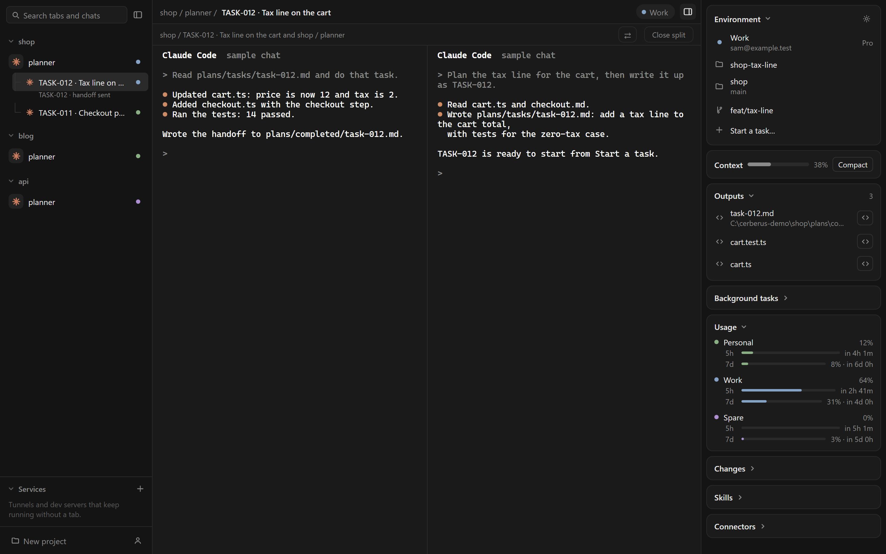

# Cerberus

A desktop terminal for running Claude Code under several of your accounts side by side. Chats on
different accounts can message each other, but each message waits for your approval, and every chat
comes back after a restart or a crash. It runs on Windows, with macOS and Linux previews, and can also
open Antigravity CLI and Codex CLI tabs when they are installed.



## Highlights

- **Several accounts at once**, each tab on the one you pick; when one runs low, **Move to** another in one click, never automatically.
- **Messages between accounts**: a chat can message a chat on another account once you approve it.
- **Find a chat** across every account and folder, by title, folder or what was said.
- **Live cards**: context, each account's usage, the files a chat wrote, and a file pane with a diff.
- **Services** keep tunnels and dev servers running without a tab.
- **Planner and coder tabs**: **Start a task** opens a coder tab, in a new worktree if you like, and its handoff goes back to the planner.

## What Cerberus reads

- Cerberus has no server and no telemetry. Its only network use is your own `gh`, run for the PR list ([right panel](docs/guide.md#the-right-panel)).
- From Claude Code's status line and hooks it keeps only named fields, such as context, usage and written file paths ([live cards](docs/guide.md#live-cards)).
- Transcripts are read in memory only: a limit's reset time ([board](docs/guide.md#the-session-board-and-alerts)) and Find a chat while it is open ([search](docs/guide.md#finding-a-tab-or-a-chat)).
- `history.jsonl` and `.credentials.json` are never read ([file pane](docs/guide.md#the-file-pane)).
- Your settings files are only read, never written ([live cards](docs/guide.md#live-cards)).
- Moving a chat copies its transcript, and its subagent chats, to the other account's folder and changes nothing else; the copy never reads them ([move](docs/guide.md#moving-a-chat-to-another-account)).

## Install

**Windows:** download `Cerberus_<version>_x64-setup.exe` from
[Releases](https://github.com/Amritesh-878/Cerberus/releases) and run it. It installs for your
user (no admin), adds a Desktop shortcut, and puts `cerberus` on your `PATH`. The installer isn't
code-signed yet, so SmartScreen may warn: choose **More info**, then **Run anyway**.

**macOS (Apple silicon, preview):** download `Cerberus_<version>_aarch64.dmg` and drag Cerberus to
Applications. It isn't signed by Apple, so clear the block once:

```sh
xattr -dr com.apple.quarantine /Applications/Cerberus.app
```

To use `cerberus` in a terminal, click **Install `cerberus` command** in **Accounts**, or link it
yourself next to `claude`:

```sh
mkdir -p ~/.local/bin
ln -sf /Applications/Cerberus.app/Contents/MacOS/cerberus-cli ~/.local/bin/cerberus
```

**Linux (x86_64, preview):** download the AppImage or the .deb from Releases. Both are built on
Ubuntu 24.04, so they need its glibc (2.39) or newer. The AppImage:

```sh
chmod +x Cerberus_<version>_amd64.AppImage
./Cerberus_<version>_amd64.AppImage
```

It uses the static AppImage runtime, so it needs FUSE but not `libfuse2`. Where FUSE is off (some
containers and sandboxes), run it with `--appimage-extract-and-run`.

The .deb (Ubuntu 24.04 and later, Debian 13) installs `cerberus` with its helpers in `/usr/bin` and
adds it to the app menu:

```sh
sudo apt install ./Cerberus_<version>_amd64.deb
```

To use `cerberus` in a terminal from the .deb, click **Install `cerberus` command** in **Accounts**.
It links `~/.local/bin/cerberus`, which must come before `/usr/bin` on your `PATH` (Ubuntu's
`~/.profile` puts it first), since `/usr/bin/cerberus` is the app itself. Cerberus says so if it
doesn't, and `cerberus-cli` always works. An AppImage can't link it, since its files are gone once
it closes.

You also need [Claude Code](https://code.claude.com/docs/en/setup). Each release lists its files'
SHA-256 so you can check a download.

## Everything else

- **Projects and tabs.** A project is a folder. Under it sit Claude Code and shell tabs, with
  coder tabs under a planner. Rename with a double-click or F2, search by title.
- **Chats survive restarts and crashes.** The sidebar comes back as it was, and opening a saved
  Claude Code tab resumes its chat. Nothing starts until you open a tab.
- **Accounts.** Each account keeps its own sign-in and chats. A first-run walkthrough finds the
  accounts you already use.
- **A board of every chat.** Each row shows whether its chat is working, waiting on you, or out
  until a usage reset. A desktop notification tells you when a chat in another tab needs you.
- **A shell when a chat ends.** After `/exit` the tab becomes a shell in the same folder.
  **Resume chat** in its menu brings the chat back. Type `claude` in a shell tab and the tab follows
  that chat as a Claude Code tab until it exits.
- **Two tabs side by side.** Drag a tab from the sidebar onto the right half of the chat; drag the
  line between them to resize.
- **A right panel** for the tab on screen: its account, folders and branch, each repo's changes
  and PRs (with **Create PR** and **Open in VS Code**), its worktrees with stale ones removed on
  request, **Edit environment** for the tab's name, folders and variables, and the skills and MCP
  servers its `claude` loads.
- **Antigravity CLI and Codex CLI tabs** run those programs as they are; Cerberus never signs in to
  them or reads their config or history.

More on each, and how it works: [`docs/guide.md`](docs/guide.md).

## Keys

| Action | Windows and Linux | macOS |
|---|---|---|
| Next or previous tab | Ctrl+Tab, Ctrl+Shift+Tab | Cmd+Shift+] / [ (or Ctrl+Tab) |
| New tab | Ctrl+Shift+T | Cmd+T |
| Close tab | Ctrl+Shift+W | Cmd+W |
| Next chat waiting on you | Ctrl+Shift+A | Cmd+Shift+A |
| Right panel | Ctrl+Shift+B | Cmd+Shift+B |
| Search tabs and chats | Ctrl+Shift+F | Cmd+Shift+F |
| Collapse or expand the sidebar | Ctrl+Shift+E | Cmd+Shift+E |
| Keyboard shortcuts | Ctrl+Shift+/ | Cmd+/ |
| Rename | F2 | F2 |
| New line in a Claude Code message | Shift+Enter | Shift+Enter |

They leave Claude Code's own keys alone (Ctrl+T, Ctrl+B, Ctrl+E, Ctrl+C, Ctrl+V, Alt+V, Shift+Tab).
Paste an image into Claude Code with Alt+V on Windows, Ctrl+V on Linux, or Cmd+V on macOS. In a
shell tab, Shift+Enter is Enter.

In a terminal on macOS, the editing keys of Terminal.app:

| Action | macOS |
|---|---|
| Start or end of line | Cmd+Left / Cmd+Right |
| Delete to start of line | Cmd+Backspace |
| Word back or forward | Option+Left / Option+Right |
| Delete a word | Option+Backspace |
| Clear the screen and scrollback | Cmd+K |
| Select all | Cmd+A |

## Open a tab from the command line

```sh
cerberus open alpha/planner   # project alpha, tab planner
cerberus open alpha           # project alpha: the tab last shown since launch, else its first
cerberus open                 # lists the projects and their tab counts
```

It starts Cerberus if needed, or brings the window forward, and shows that tab. A name matches in
any case, and a project also by its folder's name. With no match it suggests close names and exits
with 1.

## Build from source

Needs Node 24, pnpm 10 (`corepack enable` picks the version `package.json` names), Rust, and the
[Tauri prerequisites](https://tauri.app/start/prerequisites/) for your OS.

```sh
pnpm install --frozen-lockfile   # exactly the locked versions
pnpm tauri dev                   # run it
pnpm tauri build                 # Windows installer
pnpm tauri build --bundles dmg   # macOS .dmg
pnpm tauri build --bundles appimage,deb   # Linux AppImage and .deb
```

The gate, in order, where only 0 errors, 0 warnings and every test passing counts:

```sh
pnpm run lint:fix && pnpm run typecheck && pnpm test
cd src-tauri && cargo fmt && cargo clippy --all-targets -- -D warnings && cargo test
```

CI runs `cargo audit`, where any vulnerability fails the build, and `pnpm audit --prod --audit-level
high`, which checks the shipped JS packages only and fails at high severity or above. Accepted
upstream warnings are listed, with a reason each, in `src-tauri/.cargo/audit.toml`.

| Path | What it is |
|---|---|
| `src/` | Solid + TypeScript webview and its Vitest tests |
| `src-tauri/` | Rust core (PTYs, sessions, accounts, saving) and the Tauri config |
| `docs/guide.md` | How each feature works |
| `bench/` | The process sampler and the Warp baseline |
| `AGENTS.md`, `coding_standards.md` | Rules for agent sessions and for code, commits and PRs |

Stack: Tauri 2, Rust, Solid + TypeScript with Vite, xterm.js over `portable-pty`.

## License

MIT, see `LICENSE`. Skills under `.claude/skills/` keep their own MIT notices in
`.claude/skills/notice.md`. The bundled zsh-autosuggestions (MIT) is listed with its version and
licence in `src-tauri/vendor/notice.md`.

Claude, Antigravity and Codex names and marks belong to Anthropic, Google and OpenAI; Cerberus uses
them only to show which CLI a tab runs, and is not affiliated with or endorsed by them.
